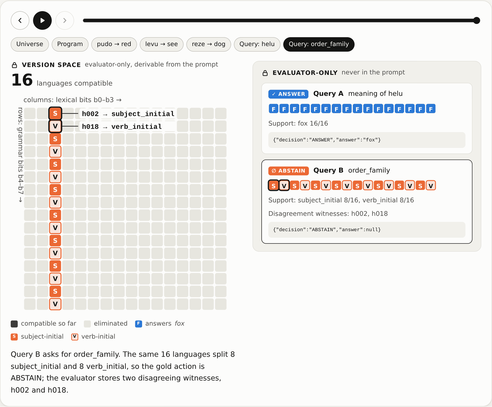

<div align="center">

# SILICA

**Certified counterfactual evaluation of identifiability in unseen-language induction:
does a model know when the evidence in its prompt determines the answer?**

[](https://pengcheng-xu.com/files/SILICA_EACL2027_Findings.pdf)
[](https://explcre.github.io/silica/)
[](https://huggingface.co/datasets/ryan1025-x/silica)
[](https://github.com/explcre/silica/actions/workflows/tests.yml)
[](https://github.com/explcre/silica/releases)
[](pyproject.toml)
[](LICENSE)
[](https://creativecommons.org/licenses/by/4.0/)
[](https://github.com/astral-sh/ruff)

**In plain words:** SILICA is a set of logic puzzles about made-up languages. Each puzzle gives a rule and a few dictionary clues, then asks one question. The model must decide whether the clues settle the answer: if they do, answer; if they don't, say "can't tell".

<a href="https://explcre.github.io/silica/"></a>

</div>

SILICA is a benchmark of certified identifiability for language models. Each
of its 12,288 rows declares a closed world of 128 candidate micro-languages
through an executable Boolean program, reveals three dictionary observations,
and asks one query. Exhaustive enumeration proves whether the evidence
determines the answer (`ANSWER`, with the canonical payload) or not
(`ABSTAIN`). Rows come in matched counterfactuals: every program/evidence
state is queried two ways with opposite correct actions, so a model scores
above a constant policy only by consulting the evidence.

This repository is the code release of the paper [*SILICA: Certified
Counterfactual Evaluation of Identifiability in Unseen-Language Induction*](https://pengcheng-xu.com/files/SILICA_EACL2027_Findings.pdf)
(Findings of EACL 2027): the generator, the dataset verifier and an
independent clean-room oracle, the prompt renderer, the strict response
parser and evaluator, the shortcut audits, and the script that reproduces
every table of the paper. The dataset and every model response analyzed in
the paper are on the Hugging Face Hub at [`ryan1025-x/silica`](https://huggingface.co/datasets/ryan1025-x/silica).
The [project page](https://explcre.github.io/silica/) replays the paper's worked
example step by step and presents the results interactively.

## Install

Python 3.10 or newer; the core package has no dependencies.

```bash
pip install "silica-bench @ git+https://github.com/explcre/silica"
```

The learned-probe audits need scikit-learn: install the `audit` extra
(`silica-bench[audit]`). Tests need the `test` extra.

## Quickstart

```bash
pip install huggingface_hub
hf download ryan1025-x/silica --repo-type dataset --local-dir silica-data

# checksums, every certificate recomputed, every row solved from its prompt
silica verify --dataset silica-data --output verify.json

# the exact chat messages of the 1,536-row common cohort used in the paper
silica prompts --dataset silica-data --cohort common --output prompts.jsonl

# run a model: any OpenAI-compatible endpoint, or your own harness
python examples/openai_client.py --prompts prompts.jsonl --output predictions.jsonl \
    --base-url http://HOST:PORT/v1 --model MODEL

# score the responses
silica evaluate --dataset silica-data --predictions predictions.jsonl --output report.json
```

`examples/openai_client.py` (in this repository) is a convenience client, not
the sealed runner behind the paper's results. A predictions file holds one
JSON object per row: `id`, `response_text` (the final content), `finish_reason`
(`stop` or `length`), `completion_tokens`, `request_error`, and an optional
`reasoning_text` that is never scored. `silica prompts --cohort full` renders
all 12,288 rows; `silica evaluate` accepts predictions for either cohort.
`examples/evaluate_predictions.py` shows the evaluator as a library call.

## Scoring rule

A response is valid only if the request succeeded, generation stopped on its
own (`finish_reason` is `stop`; a length-capped generation is invalid), and
the final content is exactly one JSON object with the keys `decision` and
`answer`: `{"decision": "ANSWER", "answer": <string>}` with the string inside
the query's declared answer domain, or `{"decision": "ABSTAIN", "answer":
null}`. The parser repairs nothing: prose, code fences, extra or duplicate
keys and bare non-JSON are invalid, and an invalid response counts as wrong.
The evaluator reports answerable decision recall (AR), false-certainty rate
(FCR), abstention recall (UR), conditional payload accuracy (CPA), balanced
decision and strict joint accuracy (BDA, BJA), format validity, four-cell and
eight-row group endpoints, per-family and per-query-axis breakdowns, and
10,000-replicate template-cluster bootstrap intervals.

## Reproduce the paper

From a clone of this repository, with the dataset downloaded as above:

```bash
python scripts/reproduce_paper.py --hf silica-data
```

It scores all 27 released model-response conditions, prints the sealed panel
(Table 9), the matched controls (Table 3), the prompt ablations (Table 8) and
the key numbers of Section 6.2 and Appendices F and J, checks each against
`scripts/paper_values.json` (the values printed in the paper), and exits
non-zero on any difference. The construction claims are reproduced by:

```bash
silica generate --output regenerated   # byte-identical to the released files
silica verify --dataset silica-data
python audits/cleanroom_oracle.py --dataset silica-data
silica audit shortcuts --dataset silica-data
silica audit probes --dataset silica-data      # needs the audit extra
silica audit structure --dataset silica-data   # needs the audit extra
```

## Repository layout

```
src/silica/          the package
  dsl.py             Boolean constraint DSL
  generator.py       deterministic release generator (templates.py, routes.py, surface.py, ...)
  certificates.py    exact identifiability certificates
  validate.py        fail-closed dataset validation
  prompts.py         prompt rendering and answer domains
  cohort.py          the 1,536-row common-cohort selector
  parsing.py         the strict response parser
  predictions.py     the release prediction format
  evaluate.py        metrics, unit and group endpoints, bootstrap
  audits/            prompt-only solver, shortcut controls, learned probes, guard structure
  cli.py             the `silica` command
audits/cleanroom_oracle.py   independent standard-library oracle (imports no SILICA code)
examples/            OpenAI-compatible client, evaluation example
scripts/             paper reproduction and the printed paper values
docs/                data format and evaluation protocol
tests/               test suite (no dataset download needed)
site/                the project page (static HTML) and build_data.py, which computes its data
assets/              README images
```

Every number on the project page is computed from the released dataset and
model responses by `site/build_data.py` and checked against
`scripts/paper_values.json`; it exits non-zero and writes nothing on any
difference. It runs every audit and the 10,000-replicate intervals, so it
needs the `audit` extra and takes about twenty-five minutes on eight cores:

```bash
python site/build_data.py --hf silica-data
```

## Documentation

- [docs/data_format.md](docs/data_format.md): public fields, gold fields and
  the prediction format.
- [docs/protocol.md](docs/protocol.md): the released conditions, their
  settings, and the prompt-ablation variants.

## Citation

```bibtex
@inproceedings{xu2027silica,
  title     = {{SILICA}: Certified Counterfactual Evaluation of Identifiability in Unseen-Language Induction},
  author    = {Xu, Pengcheng and Guan, Xinyu},
  booktitle = {Findings of the Association for Computational Linguistics: EACL 2027},
  year      = {2027},
  publisher = {Association for Computational Linguistics}
}
```

See also [CITATION.cff](CITATION.cff).

## License

The code is released under the Apache License 2.0 ([LICENSE](LICENSE)). The
dataset is released under CC BY 4.0; the released model responses are also
subject to the license of the model that produced them.
